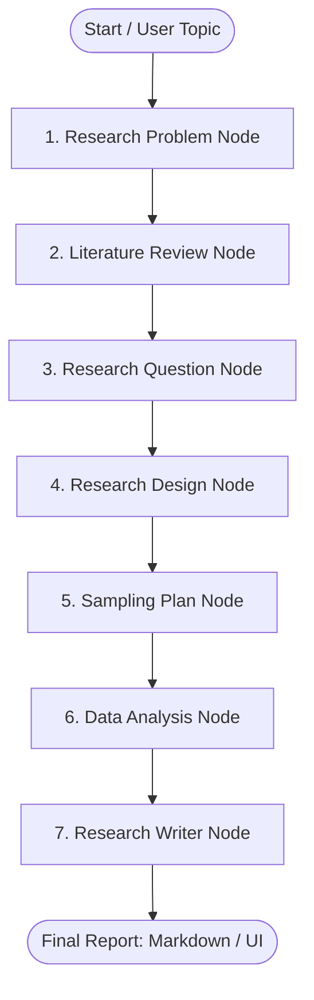

# 🧠 AI Research Assistant — Multi-Agent Research System

> An autonomous, multi-agent AI research pipeline powered by **LangGraph**, **Groq**, and **FastAPI** with a modern web dashboard.

---

## 📺 Demo Video

<div align="center">
  <video src="assets/demo.mp4" controls width="100%" style="max-height: 500px; border-radius: 10px; box-shadow: 0 4px 12px rgba(0,0,0,0.15);">
    Your browser does not support the video tag.
  </video>
</div>

---

## 🚀 Overview

The **AI Research Assistant** is an end-to-end multi-agent system designed to automate academic and technical literature investigation. Given any research topic, the pipeline coordinates specialized AI agents across discrete analytical stages to synthesize an exhaustive, publication-grade research report.

### ✨ Key Features
- **Multi-Stage Autonomous Agent Graph**: Built on **LangGraph** with discrete nodes dedicated to problem formulation, literature review, methodology, and synthesis.
- **Fast Inference**: Powered by **Groq** high-speed LLMs for near real-time agent execution.
- **RESTful API**: Fast and robust backend powered by **FastAPI** with CORS support.
- **Modern Web Interface**: Responsive, clean UI featuring real-time loading feedback and Markdown rendering via DOMPurify & Marked.js.
- **Dual Interface**: Supports both full-stack web interactions and command-line execution (CLI).

---

## 🏗️ Architecture & Agent Workflow

The workflow executes a structured sequential graph of specialized research nodes:



| Agent Node | Responsibility |
| :--- | :--- |
| **Research Problem** | Identifies core challenges, scope, and problem statements |
| **Literature Review** | Synthesizes theoretical foundations, past findings, and key literature |
| **Research Questions** | Formulates core academic hypotheses and research questions |
| **Research Design** | Outlines quantitative, qualitative, or mixed-method methodologies |
| **Sampling Plan** | Details target populations, sample sizes, and sampling techniques |
| **Data Analysis** | Specifies analytical frameworks, statistical models, and validation |
| **Research Writer** | Compiles all outputs into an executive, publication-ready research report |

---

## 📁 Project Structure

```text
├── frontend/                     # Modern Frontend UI
│   ├── index.html                # App layout & semantic markup
│   ├── styles.css                # Premium styling & dark/light accents
│   └── app.js                    # API client & Markdown renderer
├── src/
│   └── multi_agent_1/            # Core Python package
│       ├── agents/               # Agent role configurations
│       ├── config/               # Settings & environment variables
│       ├── graph/                # Graph definitions
│       ├── graph.py              # LangGraph compilation & workflow
│       ├── nodes.py              # Agent node logic & LLM prompts
│       ├── state.py              # Typed research state schema
│       ├── app.py                # FastAPI server & endpoints
│       └── main.py               # CLI runner
├── pyproject.toml                # Project dependencies & package metadata
├── requirements.txt              # Pip dependency specification
└── README.md                     # Documentation
```

---

## 🛠️ Tech Stack

- **Orchestration**: [LangGraph](https://github.com/langchain-ai/langgraph), [LangChain](https://github.com/langchain-ai/langchain)
- **LLM Engine**: [Groq](https://groq.com/) (`langchain-groq`)
- **Backend API**: [FastAPI](https://fastapi.tiangolo.com/), [Uvicorn](https://www.uvicorn.org/)
- **Frontend**: Vanilla HTML5, Modern CSS, JavaScript (Fetch API, Marked.js, DOMPurify)
- **Package Manager**: [uv](https://github.com/astral-sh/uv) / pip

---

## ⚙️ Getting Started

### 1. Prerequisites
- **Python**: `>= 3.12`
- **uv** (recommended) or **pip**
- **Groq API Key**: Obtainable from [console.groq.com](https://console.groq.com/)

---

### 2. Installation & Setup

1. **Clone the repository:**
   ```bash
   git clone https://github.com/your-username/multi-agent-1.git
   cd "Multi agent 1"
   ```

2. **Create and configure `.env`:**
   Create a `.env` file in the root directory:
   ```env
   GROQ_API_KEY=your_groq_api_key_here
   ```

3. **Install dependencies:**
   *Using `uv` (recommended):*
   ```bash
   uv sync
   ```
   *Using `pip`:*
   ```bash
   python -m venv .venv
   source .venv/bin/activate   # On Windows: .venv\Scripts\activate
   pip install -r requirements.txt
   ```

---

### 3. Running the Application

#### Option A: Full Web Application (Backend + Frontend)

1. **Start the FastAPI backend:**
   ```bash
   uv run uvicorn multi_agent_1.app:app --app-dir src --reload --port 8000
   ```
   *The API will be available at:* `http://localhost:8000` (Docs: `http://localhost:8000/docs`)

2. **Serve the frontend:**
   In another terminal, serve the `frontend/` directory:
   ```bash
   python -m http.server 3000 --directory frontend
   ```
   *Open your browser and navigate to:* [http://localhost:3000](http://localhost:3000)

---

#### Option B: Run via CLI

You can also run research workflows directly from your command line:

```bash
uv run python -m multi_agent_1.main
```
Enter your topic when prompted. The report will print in your terminal and export automatically to `research_report.md`.

---

## 🔌 API Endpoints

### `POST /research`
Generates a structured research report for a given topic.

- **Request Body:**
  ```json
  {
    "topic": "Impact of Quantum Computing on Cryptography"
  }
  ```

- **Response:**
  ```json
  {
    "topic": "Impact of Quantum Computing on Cryptography",
    "report": "# Executive Summary\n\n..."
  }
  ```

---

## 🤝 Contributing

Contributions, issues, and feature requests are welcome! Feel free to check the issues page or submit a pull request.

---

## 📄 License

This project is open-source and available under the [MIT License](LICENSE).
